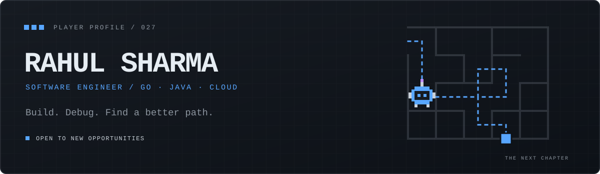
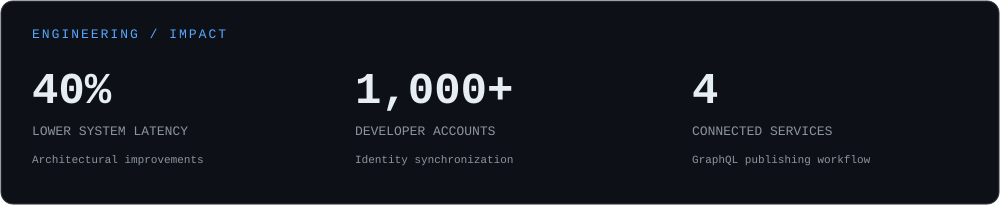
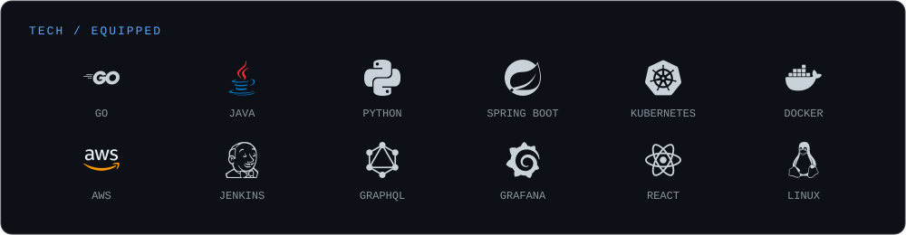
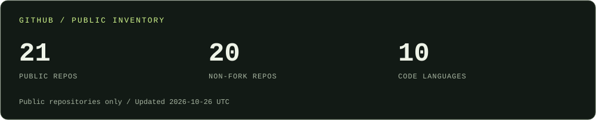
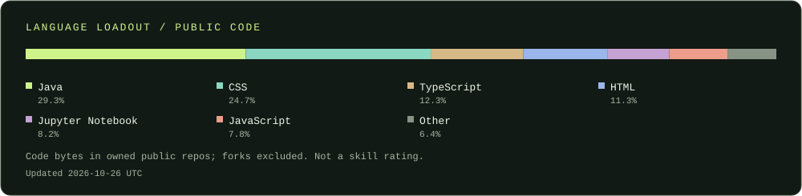
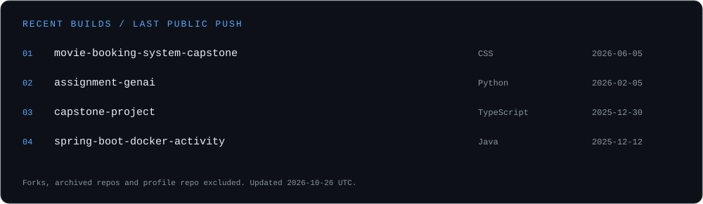

<picture>
  <source media="(max-width: 600px)" srcset="./assets/profile-banner-mobile.svg" />
  
</picture>

  <a href="https://www.linkedin.com/in/rahul-sharma-6931b914b/">LinkedIn</a> &nbsp;·&nbsp;
  <a href="mailto:rahulsharma84244@gmail.com">Email</a> &nbsp;·&nbsp;
  <a href="#selected-builds">Projects</a> &nbsp;·&nbsp;
  <a href="#how-i-work">How I work</a>

# Hey, I'm Rahul.

I'm a **software engineer in Bengaluru, India**, with experience building **Go and Java microservices, API platforms, and cloud deployments**. Previously, I worked as a contractual Software Engineer at **Cisco**, collaborating with teams across the US, India, and Europe.

I enjoy the whole journey: understanding the problem, designing the service, getting it into production, and figuring out what broke. Outside that work, I explore AI and robotics through projects I can run, share, or put on wheels.

**Current quest:** My next software engineering opportunity, with a focus on backend services, APIs, and cloud platforms.

## Production experience

**Software Engineer (contractual) · Cisco · Aug 2025 – Aug 2026**

- Owned production Go services from design through deployment and maintenance against **99.9% uptime SLAs**.
- Proposed architectural improvements that reduced **system latency by 40%** and lowered infrastructure costs.
- Built a Go integration that synchronized **1,000+ developer accounts** between Mashery and Okta, with OAuth2/JWT, mTLS, and monitoring on OpenShift.
- Implemented GraphQL publishing across **four Java and Python microservices**, including schema parsing and generated API documentation.
- Worked on CI/CD, Grafana monitoring, secure authentication, and fixes for publishing and authorization-related defects.

**Data Engineer Intern · Revature · Apr 2025 – Jul 2025**

- Built ETL pipelines with Python, SQL, and Spark, and worked on AWS data warehousing.
- Optimized queries on million-row tables, worked with Kafka streaming, and automated validation and scheduling.

<picture>
  <source media="(max-width: 600px)" srcset="./assets/engineering-impact-mobile.svg" />
  
</picture>

## My loadout

<picture>
  <source media="(max-width: 600px)" srcset="./assets/tech-loadout-mobile.svg" />
  
</picture>

- **Backend & APIs:** Go · Java · Spring Boot · Python · Flask · REST · GraphQL
- **Cloud & delivery:** Kubernetes · OpenShift · Docker · AWS · Jenkins · Linux
- **Security & observability:** OAuth2 · JWT · mTLS · RBAC · Grafana · VictoriaMetrics · Splunk
- **Data & applications:** SQL · MySQL · Kafka · Spark · Angular · React · Firebase

## Selected builds

| Build | What I worked on | Stack |
| :--- | :--- | :--- |
| [CineNow — Movie Booking](https://github.com/rahulsharma027/movie-booking-system-capstone) | A booking application with 40+ REST endpoints, JWT authentication, seat tracking, admin workflows, and a backend deployed to AWS EC2 with Docker and Jenkins. | Java · Spring Boot · Angular · MySQL · AWS |
| [AI Image Generation](https://github.com/rahulsharma027/AI-Image-Generation-App) | Led a final-year team project for generating images from prompts, with authentication and a community showcase. | React · Python · Flask · Firebase |
| [Maze-Solving Robot](https://github.com/rahulsharma027/Maze-Solving-Robot) | Led the build and worked on code, assembly, and tuning. Ultrasonic sensors and left-hand navigation help the robot find its way. | Arduino · C++ · Bluetooth |
| [Movie Recommender](https://github.com/rahulsharma027/Movie-Recommender-System) | A movie recommendation application using cosine similarity, with a Streamlit interface. | Python · Streamlit |

## How I work

| Principle | What it looks like in my work |
| :--- | :--- |
| **Ownership** | Stay with a service through design, deployment, monitoring, and production support. |
| **Dive deep** | Trace issues across services, from schema parsing and routing defects to timing and path-validation bugs. |
| **Invent and simplify** | Replace a legacy integration with a focused Go service and automate repeatable delivery and data tasks. |
| **Earn trust** | Collaborate across regions, explain technical decisions, and follow through on shared work. |
| **Deliver results** | Connect architectural changes to measurable outcomes, including latency reduction and reliable account synchronization. |
| **Learn and be curious** | Keep exploring beyond my day-to-day stack, from image generation to a physical maze-solving robot. |

## GitHub field notes

<picture>
  <source media="(max-width: 600px)" srcset="./assets/github-snapshot-mobile.svg" />
  
</picture>

<picture>
  <source media="(max-width: 600px)" srcset="./assets/language-loadout-mobile.svg" />
  
</picture>

<picture>
  <source media="(max-width: 600px)" srcset="./assets/recent-builds-mobile.svg" />
  
</picture>

Public repository data only. Language share measures code bytes, not skill level. Cards refresh weekly once the included GitHub Actions workflow is enabled.

## Beyond the API

As a kid, I wanted to build a robot. In college, I finally did. The maze-solving project brought together code, wiring, assembly, and plenty of tuning — a different kind of debugging.

[Watch the robot in action →](https://www.youtube.com/shorts/KKV-1y4Cs_s)

  
<strong>Education & certifications</strong>

- **B.Tech, Computer Science & Engineering (AI)** — Poornima Group of Institutions, 2024 · CGPA: 8.9
- Cisco Certified AI Technical Practitioner (810-110)
- Cisco Certified CCNA Automation (200-901)
- Microsoft Azure DP-900
- Java Full Stack Developer — Simplilearn
- Python Essentials & Data Foundations

---

**Have a backend or platform problem worth solving?** [Let's connect.](https://www.linkedin.com/in/rahul-sharma-6931b914b/)
